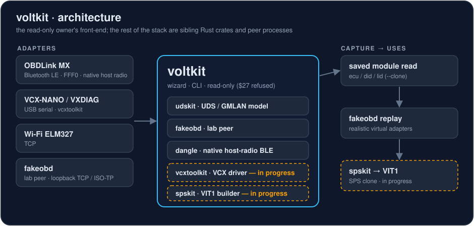

<p align="center">
  
</p>

<p align="center">
  <b>The open, read-only diagnostic front-end for one car.</b><br>
  Scan a GM Chevrolet Volt / Bolt over an ELM327 or the VCX-NANO, capture its modules,
  and feed that capture back into emulation and the SPS clone — without ever writing to the vehicle.
</p>

<p align="center">
  <a href="#quickstart">Quickstart</a> ·
  <a href="#how-it-works">How it works</a> ·
  <a href="#safety--scope">Safety</a> ·
  <a href="#roadmap">Roadmap</a> ·
  <a href="docs/tool-boundary.md">Tool boundary</a>
</p>

---

## What is voltkit

`voltkit` is the user interface for one car. It speaks ELM327 command lines to an adapter, reads the
Volt's identifiers and live gauges, and writes a **capture** — a saved module read — that the rest of
the stack reuses. It is deliberately **read-only**: only the diagnostic *read* services `01`, `03`,
`1A`, and `22` ever reach the adapter, and SecurityAccess (`$27`) is refused before a byte is written.

The protocol knowledge is shared, not hand-rolled: voltkit links the sibling **`udskit`** crate for
the UDS / GMLAN model, and the other tools in the stack are separate processes or optional Rust
features — so a real build carries only what it needs.

<p align="center">
  
</p>

## Features

- **Read-only by design** — `$27` and every write service are refused before the socket write; only `01/03/1A/22` are sent.
- **Capture & clone** — `voltkit profile ... --clone` writes a module read that doubles as a `fakeobd` profile and as the input to the SPS / VIT1 request.
- **Interactive wizard** — a full-screen terminal UI (or line prompts over a pipe) that asks which capture to run and sends nothing until you say yes.
- **Live gauges** — six scaled `$22` reads (state of charge, temperatures, range) printed from the adapter.
- **VIN shape check** — validates a 2016–2019 US Volt / Bolt EV VIN against GM's NHTSA filings (check digit + card).
- **Multiple adapters** — a Wi-Fi/USB ELM327, an OBDLink **MX** over Bluetooth, or the **VCX-NANO** over USB.
- **Lean builds** — the shared UDS model is linked; the lab/emulation peers are optional and stay out of a real build.

## Quickstart

> **Build prerequisite:** voltkit has a path dependency on the sibling **`udskit`** crate (`../udskit`).
> Clone `udskit` into the same parent directory first, or the build won't resolve.

```bash
git clone https://github.com/b1tninja-labs/udskit
git clone https://github.com/b1tninja-labs/voltkit
cd voltkit
cargo build --release
cargo run -- wizard          # interactive capture
```

## Capture a real vehicle

Plug the adapter into the car's OBD-II port (it powers from the port — engine off is fine) and point
voltkit at it. Capture **once**; the same file drives the bench emulation and the SPS clone.

<p align="center">
  
</p>

**OBDLink MX over Bluetooth** — the host radio opens the dongle via `obd-bridge`, which republishes it
as ELM327-over-TCP. Confirm it's visible first (a read-only pre-flight, no vehicle needed):

```bash
obd-bridge scan --scan-timeout 10     # lists nearby BLE advertisers; the MX's FFF0 row is marked
obd-bridge --name OBDLink              # republishes the MX on 127.0.0.1:35000
cargo run -- profile 127.0.0.1:35000 --set hardware --set parts --set identity --clone --output ../volt-capture.profile
```

**USB / Wi-Fi ELM327** — if the adapter enumerates as a COM port or a Wi-Fi socket, dial it directly:

```bash
cargo run -- profile COM5 --set hardware --set parts --set identity --clone --output ../volt-capture.profile
cargo run -- profile 192.168.0.10:35000 --set charger --set climate --clone
```

The `--clone` file is a `fakeobd` profile (replay the car on a bench) **and** the saved module read the
SPS / VIT1 request is built from. Captures hold a real VIN and part numbers — they are gitignored and
belong **outside** the repository.

## Usage

| Command | What it does |
| --- | --- |
| `voltkit wizard` | Pick a capture interactively; full-screen UI in a terminal, line prompts over a pipe. |
| `voltkit profile <target> [--set …] [--range …] [--clone]` | Capture identifiers from an adapter (TCP or Windows COM) and optionally write a clone profile. |
| `voltkit profile --list` | List the capture sets (`hardware`, `parts`, `identity`, `charger`, `climate`, `cells`, …). |
| `voltkit gauges --host 127.0.0.1:<port>` | Print six scaled `$22` gauge fields (loopback only). |
| `voltkit <host:port>` | Run the trial read session against a loopback ELM327-over-TCP peer. |
| `voltkit lab` | Start the `fakeobd` lab peer on `127.0.0.1:35000` and dial it. |
| `voltkit bench` | Start `obd-bridge --name OBDLink` (a real BLE adapter → TCP) and dial it. |

Depth on the capture sets, the clone format, and the programming-read fields is in
[docs/capture.md](docs/capture.md); who owns what in the stack is in
[docs/tool-boundary.md](docs/tool-boundary.md).

## How it works

The session is the ELM327 datasheet reset — `ATZ ATL0 ATH0 ATS0 ATSP6 ATE0 ATCAF1` — where `ATSP6`
selects ISO 15765-4 CAN, 11-bit, 500 kbaud. The scan set, the headers, and the flow-control came from
a real 2026-11-14 vehicle trial, so the protocol content is vehicle-derived, not guessed. Every
protocol value is anchored to a standard read through the `primarysource` tools, never from memory.

## Safety & scope

voltkit is a read client and nothing more:

- Only `01`, `03`, `1A`, and `22` reach the adapter; `$27` (SecurityAccess) is refused **before** the write.
- No vehicle writes, no SecurityAccess seed/key, no J2534 pass-through DLL.
- It does not hold the money, post to GM's SPS, or program a module.
- A capture from a car (its VIN, part numbers) stays on your machine: `*.profile`, `profiles/`, `captures/`, and `scans/*` are gitignored.

## Roadmap

voltkit today links `udskit` and spawns the lab/bench peers. The in-progress direction (marked in the
diagrams) unifies the real-vehicle path into one linked Rust stack:

- **Adapter drivers as Cargo features** — `vcx` (the VCX-NANO via `vcxtoolkit`) **on by default** since it's a real adapter (Windows-gated so the Linux build stays lean); `lab` (the `fakeobd` emulation peer) optional and **off** in real builds.
- **VCX doctor in the wizard** — a GetInfo pre-flight for the VCX-NANO (already proven on hardware), plus an adapter/driver chooser (native driver now; a registered J2534 pass-through gated until the SAE J2534 spec is sourced).
- **Rust `spskit`** — the SPS / VIT1 request builder ported to Rust so voltkit links it directly instead of shelling out.

## For contributors & agents

A one-page handoff for setting up and running a capture — the `udskit` sibling, the peer processes,
the collection flow, and the guardrails — is in [docs/tool-boundary.md](docs/tool-boundary.md) and
[docs/capture.md](docs/capture.md). Run the checks with `cargo test`; they use an in-process TCP peer
or a stub binary and never open a real adapter or need a vehicle.

## Release

`Cargo.toml` sets `publish = false` — voltkit is distributed as GitHub Release binaries, not on
crates.io. Pushing a `v*.*.*` tag runs `.github/workflows/release.yml`, which checks out voltkit and
`udskit` as siblings, runs `cargo fmt --check` / `cargo clippy --all-targets -- -D warnings` /
`cargo test` on Ubuntu and Windows, and attaches two binaries plus `SHA256SUMS`:

- `voltkit-x86_64-pc-windows-msvc.exe` (static CRT — no Visual C++ redistributable needed)
- `voltkit-x86_64-unknown-linux-gnu`

A pull request and any push run the same checks via `.github/workflows/ci.yml` without publishing.

## License

MIT OR Apache-2.0.
