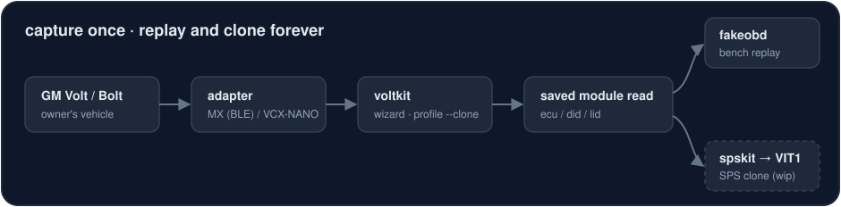

<p align="center">
  
</p>

<p align="center">
  <b>The open, read-only diagnostic front-end for one car.</b><br>
  Scan a GM Chevrolet Volt / Bolt over an ELM327 or the VCX-NANO, capture its modules,
  and feed that capture back into emulation and the SPS clone — without ever writing to the vehicle.
</p>

<p align="center">
  <a href="#quickstart">Quickstart</a> ·
  <a href="#how-it-works">How it works</a> ·
  <a href="#safety--scope">Safety</a> ·
  <a href="#roadmap">Roadmap</a> ·
  <a href="docs/tool-boundary.md">Tool boundary</a>
</p>

---

## What is voltkit

`voltkit` is the user interface for one car. It speaks ELM327 command lines to an adapter, reads the
Volt's identifiers and live gauges, and writes a **capture** — a saved module read — that the rest of
the stack reuses. It is deliberately **read-only**: only the diagnostic *read* services `01`, `03`,
`1A`, and `22` ever reach the adapter, and SecurityAccess (`$27`) is refused before a byte is written.

The protocol knowledge is shared, not hand-rolled: voltkit links the sibling **`udskit`** crate for
the UDS / GMLAN model, and the other tools in the stack are separate processes or optional Rust
features — so a real build carries only what it needs.

<p align="center">
  
</p>

## Features

- **Read-only by design** — `$27` and every write service are refused before the socket write; only `01/03/1A/22` are sent.
- **Detect & select the adapter** — `voltkit wizard` lists the adapters it finds — COM ports by their friendly name, a VCX-NANO by model and firmware, an OBDLink **MX** seen over Bluetooth, a remembered Wi-Fi target — and you pick one. No typing `COM5`.
- **Guided clone, auto-written** — pick an adapter, pick a capture, and voltkit runs the reads and writes the `fakeobd` profile for you, named from the job and the time, **outside** the repository. You never type a `--set` or a profile path.
- **Live gauges** — six scaled `$22` reads (state of charge, temperatures, range) printed from the adapter.
- **VIN shape check** — validates a 2016–2019 US Volt / Bolt EV VIN against GM's NHTSA filings (check digit + card).
- **Adapter paths** — a Wi-Fi/USB ELM327, a Windows COM port, an OBDLink **MX** reached through a managed `obd-bridge`, or the **VCX-NANO** over USB (identify-only for now).
- **Lean builds** — the shared UDS model is linked; the VCX driver is a Windows-gated default feature and the lab/emulation peer is an optional one, so a real build carries only what it needs.

## Quickstart

> **Build prerequisite:** voltkit has path dependencies on sibling crates. Cargo resolves every
> declared path dependency even when its feature is off, so clone **`udskit`**, **`vcxtoolkit`**, and
> **`fakeobd`** into the same parent directory first, or the build won't resolve. Only `udskit` is
> compiled into a default Linux build; `vcxtoolkit` is compiled on Windows (the default `vcx`
> feature); `fakeobd` is compiled only with `--features lab`.

```bash
git clone https://github.com/b1tninja-labs/udskit
git clone https://github.com/b1tninja-labs/vcxtoolkit
git clone https://github.com/b1tninja-labs/fakeobd
git clone https://github.com/b1tninja-labs/voltkit
cd voltkit
cargo build --release
cargo run -- wizard          # detect an adapter, pick a capture, auto-write the profile
```

## Capture a real vehicle

Plug the adapter into the car's OBD-II port (it powers from the port — engine off is fine) and run
the wizard. Capture **once**; the same file drives the bench emulation and the SPS clone.

<p align="center">
  
</p>

**The guided path — `voltkit wizard`.** The wizard is a **two-phase, two-adapter** flow, because the
OBDLink MX and the VCX-NANO collect different halves of the picture. In a terminal it is a full-screen
UI: pick the capture, pick the adapter from a detected list, and it runs the reads for you — no typed
COM port, `--set`, or path.

**Phase 1 — module clone (ELM327-class):** the read-only `$1A`/`$22` module reads + gauges, written as
a `fakeobd` profile.

- **COM ports** are listed with their friendly USB name (so you recognise the OBDLink from the mouse).
- **An OBDLink MX** found over Bluetooth is one selectable entry. Pick it and voltkit manages
  `obd-bridge` under the hood — it spawns the bridge, waits for it, and captures through it. You never
  run `obd-bridge` yourself.
- **A Wi-Fi/TCP** target you used before is remembered and offered; manual entry is always there as a
  fallback.

The profile is written to `~/voltkit-captures/volt-<job>-<timestamp>.profile`, outside any repository.

**Phase 2 — programming data (VCX-NANO over USB):** the SPS / VIT1 read the ELM327 MX cannot reach
(it needs the VCX pass-through). A VCX-NANO is detected, identified with vcxtoolkit's GetInfo doctor
(model + firmware), and selected here. **The live SPS read is gated** — the `VCX_PRO_Recv` byte layout
is not recovered — so Phase 2 today only runs the safe doctor and **stages** the collect: it writes a
gated, spskit-compatible skeleton (`~/voltkit-captures/sps-collect-<serial>-<timestamp>.json`) listing
the programming-data reads with empty values and a `gated` status. No vehicle read is sent; a later,
ungated collect or spskit fills the values. The two captures together are the complete picture.

**Power-user CLI.** The same capture is scriptable, for CI or a saved recipe:

```bash
cargo run -- profile COM5 --set hardware --set parts --set identity --clone --output ../volt-capture.profile
cargo run -- profile 192.168.0.10:35000 --set charger --set climate --clone
```

The `--clone` file is a `fakeobd` profile (replay the car on a bench) **and** the saved module read the
SPS / VIT1 request is built from. Captures hold a real VIN and part numbers — they are gitignored and
belong **outside** the repository.

## Usage

| Command | What it does |
| --- | --- |
| `voltkit wizard` | Detect and select an adapter, pick a capture, run it, and auto-write the profile. Full-screen UI in a terminal; line prompts over a pipe. |
| `voltkit profile <target> [--set …] [--range …] [--clone]` | Capture identifiers from an adapter (TCP or Windows COM) and optionally write a clone profile. |
| `voltkit profile --list` | List the capture sets (`hardware`, `parts`, `identity`, `charger`, `climate`, `cells`, …). |
| `voltkit gauges --host 127.0.0.1:<port>` | Print six scaled `$22` gauge fields (loopback only). |
| `voltkit <host:port>` | Run the trial read session against a loopback ELM327-over-TCP peer. |
| `voltkit lab` | Start the `fakeobd` lab peer on `127.0.0.1:35000` and dial it (or, with `--features lab`, serve it in-process). |
| `voltkit bench` | Start `obd-bridge --name OBDLink` (a real BLE adapter → TCP) and dial it; the wizard does this for you when you pick an MX. |

Depth on the capture sets, the clone format, and the programming-read fields is in
[docs/capture.md](docs/capture.md); who owns what in the stack is in
[docs/tool-boundary.md](docs/tool-boundary.md).

## How it works

The session is the ELM327 datasheet reset — `ATZ ATL0 ATH0 ATS0 ATSP6 ATE0 ATCAF1` — where `ATSP6`
selects ISO 15765-4 CAN, 11-bit, 500 kbaud. The scan set, the headers, and the flow-control came from
a real 2026-11-14 vehicle trial, so the protocol content is vehicle-derived, not guessed. Every
protocol value is anchored to a standard read through the `primarysource` tools, never from memory.

## Safety & scope

voltkit is a read client and nothing more:

- Only `01`, `03`, `1A`, and `22` reach the adapter; `$27` (SecurityAccess) is refused **before** the write.
- No vehicle writes, no SecurityAccess seed/key, no J2534 pass-through DLL.
- It does not hold the money, post to GM's SPS, or program a module.
- A capture from a car (its VIN, part numbers) stays on your machine: `*.profile`, `profiles/`, `captures/`, and `scans/*` are gitignored.

## Roadmap

voltkit links `udskit`, detects and selects adapters in the wizard, and manages `obd-bridge` for the
MX path. What landed and what is still ahead:

- **Adapter drivers as Cargo features** — *done.* `vcx` (the VCX-NANO via `vcxtoolkit`) is **on by default** (Windows-gated, so the Linux build stays lean); `lab` (the `fakeobd` emulation peer, now linked as a library for an in-process bench) is optional and **off** in real builds.
- **Detect & select in the wizard** — *done.* COM ports with friendly names, a VCX-NANO identified by GetInfo, and MX devices from `obd-bridge scan`, presented as a pick list with auto-written profiles. A registered J2534 pass-through stays a greyed option until the SAE J2534 spec is sourced (it is not in primarysource).
- **Two-phase flow** — *done.* Phase 1 is the ELM module clone; Phase 2 identifies the VCX-NANO (safe doctor) and **stages** a gated spskit-compatible skeleton of the programming-data read.
- **VCX live capture** — *ahead (held).* Phase 2 stages the collect but does not run it — vcxtoolkit's live `collect` stays gated (the `VCX_PRO_Recv` byte layout is not recovered), awaiting owner sign-off.
- **Native host-OS BLE** — *ahead.* The MX path still goes through the `obd-bridge` process. Dropping that hop needs obd-bridge to expose a BLE library crate (it is bin-only today) or voltkit's own WinRT BLE.
- **Rust `spskit`** — *ahead.* The SPS / VIT1 request builder ported to Rust so voltkit links it directly instead of shelling out.

## For contributors & agents

A one-page handoff for setting up and running a capture — the `udskit` sibling, the peer processes,
the collection flow, and the guardrails — is in [docs/tool-boundary.md](docs/tool-boundary.md) and
[docs/capture.md](docs/capture.md). Run the checks with `cargo test`; they use an in-process TCP peer
or a stub binary and never open a real adapter or need a vehicle.

## Release

`Cargo.toml` sets `publish = false` — voltkit is distributed as GitHub Release binaries, not on
crates.io. Pushing a `v*.*.*` tag runs `.github/workflows/release.yml`, which checks out voltkit and
its `udskit` / `vcxtoolkit` / `fakeobd` siblings, runs `cargo fmt --check` / `cargo clippy
--all-targets -- -D warnings` / `cargo test` / `cargo doc --no-deps` on Ubuntu and Windows, and
attaches two binaries plus `SHA256SUMS`:

- `voltkit-x86_64-pc-windows-msvc.exe` (static CRT — no Visual C++ redistributable needed)
- `voltkit-x86_64-unknown-linux-gnu`

A pull request and any push run the same checks via `.github/workflows/ci.yml` without publishing.

## License

MIT OR Apache-2.0.
