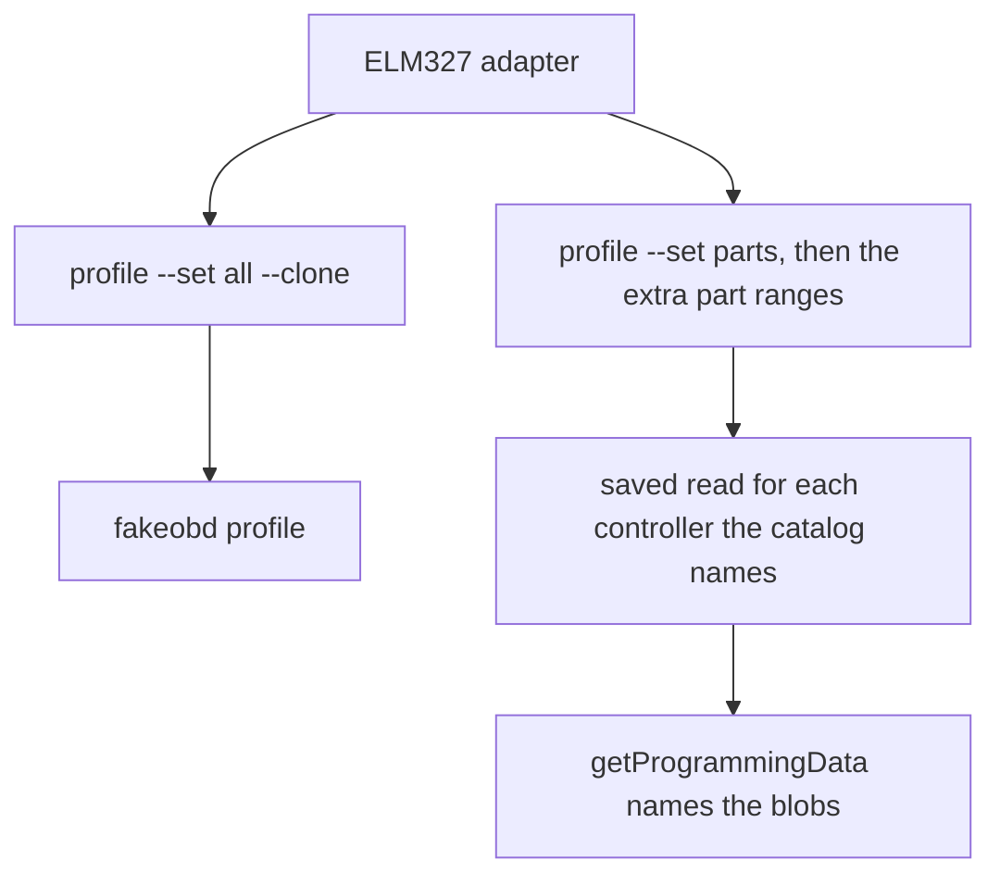

# Capturing a car for the lab and for a programming read

`voltkit profile` speaks ELM327. It is the reader for the lab profile that `fakeobd` serves. The VCX frame port is a different tool: `vcx-probe` asks the dongle who it is, and the pass-through reply body is not recovered, so this command does not send vehicle bytes on that port.

The session and gauge commands stay on loopback. `profile` dials the TCP address the operator passes, or on Windows opens the COM port they pass, at 115200 unless `--baud` says otherwise. `$27` is refused before it is written. Write services are refused. The socket will carry services `01`, `03`, `1A`, and `22`. The capture tables below send `1A` and `22` only.

A device id in the programming client is not a CAN header. K17's device id is 40, and Voltage module 40 is header `241`. That number match is the one recorded here. No other device id in `spskit` `vit1.py` is paired with a header in this note.



## Commands

```text
voltkit profile --list
voltkit profile HOST:PORT [--set NAME]... [--range HEADER 22|1A START END]... [--clone]
voltkit profile COMn [--baud 115200] [--set NAME]... [--range HEADER 22|1A START END]... [--clone]
```

`--list` prints the set names and does not open a socket. With no `--set` and no `--range`, the command runs `all`. `--clone` writes the lab profile on stdout and the dialogue on stderr. Redirect stdout to a file outside the repository. A capture from a car contains that car's module bytes.

`--range` walks one 11-bit header. The service is `22` or `1A`. The span is at most 256 identifiers. `$1A` identifiers are one byte. Service `$27` is refused before a socket is opened. Headers `241`, `244`, and `24C` set the response filters the lab profile already records (`641`, `644`, `64C`). Any other header, including `621`, leaves the filter unset.

## Sets

| Set | What it asks |
| --- | --- |
| `all` | The lab profile capture. It does not include `parts`. |
| `scan` | The 2026-11-14 trial only. |
| `hpcm` | Header `7E0`. |
| `powertrain` | Header `7E1`. |
| `becm` | Header `7E4`. |
| `charger` | The charger screen on `7E4`, including `$1A` `A4` and `75`. |
| `cells` | `7E7` identifiers `4181` through `4250`, plus `82A3` and `40D4`. |
| `climate` | `801F`, `82B2`, `817B`, `41B4`, `41B2`, `82B5`, `451E` on `241`. |
| `body` | The other `241` reads. |
| `cluster` | Header `244`. |
| `identity` | Every `$1A` read already in the lab capture. |
| `parts` | `$1A` `C0` through `CA` on `7E0`, `7E1`, `7E4`, `7E7`, and `241`. |

`cells` follows the lab table through `4240` and then the Voltage catalog tail `4241` through `4250`. That catalog calls `4202` through `4250` battery cell voltages and config, and it does not name a header. `7E7` is the cell ECU the lab profile already uses for `4181` through `4240`.

## The clone

A positive `$22` reply becomes `did IIII HEX`, using the bytes after `62` and the identifier. A positive `$1A` reply becomes `lid II HEX`, using the bytes after `5A` and the identifier. A negative reply is counted and left out. The same identifier on the same header is kept once.

The file starts with `s3 5000`. Each answered header that has a recorded response id becomes one `ecu` line. The names, response ids, functional flag, and latency are the lab profile's values, so a clone sits on the same bus shape. The order is `7E0`, `7E4`, `244`, `241`, `24C`, `7E1`, `7E7`. Mode `01`, freeze frames, and DTCs are not in the capture.

A header with no recorded response id is a comment. `621` is that case. The comment is the `did` or `lid` line, then a line that says the header has no recorded response id.

For `$1A` `C0` through `CA`, when at least four data bytes came back, the line comments the decimal of those four bytes. That is the part-number slice: the identifier echo is not included, and the next four bytes are an unsigned integer, first byte most significant. In `spskit`, `format0_decimal` takes the same four bytes from a longer buffer whose byte 2 is the service and whose start byte 1 is response byte 4. A `$7F` in that buffer writes no number. A short payload is not a part number.

`fakeobd serve --profile FILE` parses this file. A sample clone was loaded on `127.0.0.1:35991` and read back: `224532` returned `did 4532 0001`, `1AC1` returned `lid C1` with decimal 42, and `224250` returned `did 4250 BBE0`. That server was stopped. The sample used synthetic bytes, not a car.

There is no second profile format for a project named fakevolt or obdkit. The clone is the lab profile, and this client is the reader.

## Voltage emulation

`voltkit profile COMn --set all --clone` is the emulation pass. It covers the 2026-11-14 trial and the lab profile: powertrain on `7E1`, HPCM2 on `7E0`, BECM and the charger screen on `7E4`, climate and the other body reads on `241`, the cluster on `244`, the `$1A` placeholders on `24C`, and the cell table on `7E7`.

These reads are still outside that pass:

- The hub trial counted two service `01` requests and one service `03` request. The command bytes and the header in effect are not recorded in this note, so they are not in the table.
- The Voltage 2.3.0 catalog lists 115 `$22` identifiers. The cell block is asked on `7E7`. A catalog identifier with no header in the lab profile or in `profile_table` is not sprayed across every header.
- The appendix names more request headers than this command uses (`242`, `247`, `24B`, `251`, `252`, `255`, `257`, `258`, `7E2`, `7E5`, `7E6`, and others). A presence check is `$1A` `90` on a header only when that document already pairs a response filter. This note does not copy an unverified pair. The filters this command sets are `641`, `644`, and `64C`.
- The single-wire wake frames from the trial are not module data, and they are not sent.

Service `$27` and the write services stay out. The simulator refuses them. The app continued after that refusal, so emulation of that moment is the refusal, not a captured seed.

The checked-in `fakeobd` profile is on another branch and was not edited from here. It still lacks the seven climate reads on `241` and the charger identifiers `4532`, `4530`, `452F`, `A4`, and `75`. A clone from the car is what fills those. `all` already asks for them.

## Programming read

The programming client is `spskit`. `vit1.py` turns a saved module read into the VIT1 block on `getProgrammingData`. This crate does not post that request, and it does not download a calibration. A posted K17 request with no VIT1 came back `VIT_NO_VALID_CMB`. The catalog's suggested part numbers are not the module read. The calibration file is named from the module's own part numbers.

Collect a complete row only for the controllers that VIN's SPS catalog names. The traced car's catalog is described in `spskit` `docs/calibration-downloads.md`. One missing part identifier and the builder will not attach the read.

Keep the raw `$1A` payload. The decimal comment is the part slice, and the hex is what a later step needs when the hardware field is a string rather than a decimal. A negative reply is not a zero.

| Controller | Method | Part identifiers | Hardware | Also |
| --- | --- | --- | --- | --- |
| K17 | 11228 | `C1`–`CA` | `CC`, the string from the read | `$90` |
| K33 | 11231 | `C1`–`CA` | `CC`, four-byte decimal | `$90` |
| K20 | 11229 | `C1`–`CA` | `CC`, decimal | `$90`, and the CVN flag |
| K9 | 410 | `C1`–`CA`, then `41`–`4A` | `CC`, decimal | `$90` |
| A22 | 446 | `C1` | `CB`, decimal | |
| A11 | 432 | `C1`, `C3`–`CA`, `73` | `CB`, decimal | |
| B218R | 11243 | `C1`–`CA` | `CB`, decimal | |
| B218L | 11239 | `C1`–`CA` | `CB`, decimal | |
| B233B | 388 | `C1`–`C2` | `CB`, decimal | |
| K43 | 417 | `C1`–`C3` | `CB`, decimal | |
| K84 | 427 | `C1`–`C3` | `CB`, decimal | |
| T3 | 434 | `C1`, `CA` | `CB`, decimal | |
| K182 | 423 | `C1`–`C2` | `CB`, decimal | |
| K109 | 428 | `C1`–`C2` | `CB`, decimal | |
| K177 | 416 | `C1`–`C2` | `CC`, decimal | |
| K107A | 531 | `C1`–`C3` | `CB`, decimal | CVN flag |
| K107B | 532 | `C1`–`C3` | `CC`, decimal | CVN flag |
| K118 | 530 | `C1`–`C2` | none | |
| P16 | 11242 | `C1`–`CA`, plus `40`, `42`, `44`, `67`, `69`, `71`, `74`, `76` | `CB`, decimal | `$90` |
| K73 | 601 | none | `CB`, decimal | `$90` |
| K124 | 396 | `C1`–`CA`, plus `60`, `62`, `64`, `66`, `68`, `6A` | `CB`, decimal | |
| K74 | 579 | `C2`–`CA`, `71` | `C1`, decimal, the same width as a part | |
| K114B | 529 | `C1`–`C2` | none | `$90` |
| K36 | 421 | `C1`–`C3` | `C1`, the same read as the first part | `$90` |

K17's hardware length is 0, so `ssecuhn` stays the string from `$CC`. The other hardware cells in the table are the four-byte decimal. `$90` is collected only on the rows that say so.

K16 is not in the table. Its part list is the string `P;C0,C1,C2` with length 0, and the builder does not split it. K73 request methods 520 and 566 copy three hardware bytes and do not turn that copy into `ssecuhn`.

`voltkit profile COMn --set parts --clone` asks `$1A` `C0` through `CA` on five headers. The extra identifiers a full row can need, beyond that span, are `40`, `41` through `4A`, `60`, `62`, `64`, `66`, `68`, `6A`, `67`, `69`, `71`, `73`, `74`, `76`, and `CB`. Ask those with `--range` on a header that already answered. The command does not yet know which controller owns the header.

That saved read is what lets `getProgrammingData` name each blob, its size, its download id, and the server list. Fetching the file is the following SPS call. Putting a blob on a module is a later write, and it is outside this capture.
