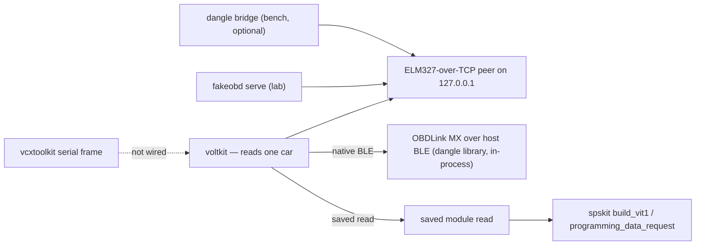

# Who talks to the tool

`voltkit` is the user interface for one car. A peer on the other end of a socket is a separate
process, chosen here and started here. The optional, feature-gated library links are `udskit`
(the UDS/GMLAN model), `vcxtoolkit` (the VCX-NANO doctor, `vcx` feature), `dangle` (the native
host-radio BLE library, `ble` feature), and `fakeobd` (the in-process bench, `lab` feature).
voltkit opens the host Bluetooth radio to reach an OBDLink MX, but only to carry the same reads —
it still does not speak SPS HTTP or the VCX frame, and `spskit` and `dangle`'s TCP-bridge binary
stay separate processes it never links. The same split is written in `spskit`'s and `vcxtoolkit`'s
`docs/tool-boundary.md`.

## This crate

`voltkit` speaks ELM327 command lines and reads one car. It opens the transport, sends the
reset-and-format sequence and the scan, and prints the dialogue. The only diagnostic services it
will carry are `01`, `03`, `1A`, and `22`. `classify` refuses `$27` before the byte is written,
and there is no write service (`$2E`, `$2F`, `$31`, `$11`, `$14`, `$34`–`$37`, `$85`). The
session and gauge commands stay on loopback; `voltkit profile` dials the TCP address the operator
passes, on Windows opens the COM port they pass, or — for a `ble:<address>` target from the
wizard's native scan — opens the dongle over the host Bluetooth radio in-process through `dangle`;
every path still sends only reads. `dangle` is a dumb byte pipe: no write or program path crosses
it. `ATSP6` selects ELM protocol 6 (ISO 15765-4 CAN, 11-bit, 500 kbaud); that number is not a
statement about ISO 15765-2.

The handoff to a separate peer is a TCP address, a profile file, or a saved module read. Nothing
passes across it but those three.

## Native BLE and the lab/bench peers — `dangle`, `fakeobd`

An OBDLink MX (and any FFF0-style BLE serial dongle) is reached natively: the wizard scans the
host radio and opens the dongle in-process through the `dangle` BLE library (the `ble` feature,
Windows-gated), then drives the ELM327 session over the returned byte pipe. No process is spawned
and no TCP socket is used for the native BLE path.

`voltkit lab` spawns the `fakeobd` binary (`fakeobd serve --listen 127.0.0.1:35000`) and dials it.
`voltkit bench` is the optional bring-the-bridge path: it spawns the `dangle` binary
(`dangle --name OBDLink`) — the same crate's TCP bridge, not its library — and dials
`127.0.0.1:35000`, for example to reach the radio from an emulator. Both are spawned, not linked,
and `VOLTKIT_LAB_PEER` and `VOLTKIT_BENCH_PEER` name the binary when it is not on `PATH`.
`gattmirror` is the Android-emulator HCI mirror, not this TCP peer.

## The SPS peer — `spskit`

`spskit` builds a VIT1 programming-data body from a saved module read (`vit1.build_vit1`,
`vit1.programming_data_request`). It does not post the body and it does not program the car.
`voltkit profile` prints the programming-read fields and writes the saved module read that is the
contract; the body itself is built on the other side. Nothing here calls `spskit`, and there is
no `fakesps` peer yet — a shell is not created until a captured exchange is that contract. See
`spskit`'s `docs/tool-boundary.md`.

## The dongle — `vcxtoolkit`

`vcxtoolkit` owns the dongle: the serial frame, `GetInfo`, the license, and the firmware catalog.
`voltkit` does not pack a VCX frame, open the USB serial port, add a `PassThru*` export, or write
`PassThruSupport.04.04`. The fifteen `PassThru*` exports stay unbuilt until SAE J2534 is imported
into primarysource. See `vcxtoolkit`'s `docs/tool-boundary.md`.

