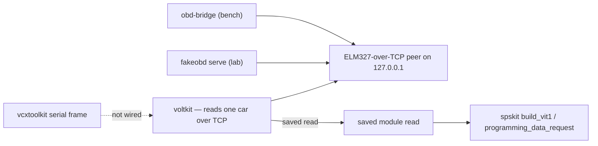

# Who talks to the tool

`voltkit` is the user interface for one car. The peer on the other end of its socket is a
separate process, chosen here and started here, but never linked here. This crate does not take
a crate dependency on `fakeobd`, `obd-bridge`, `spskit`, or `vcxtoolkit`, and it does not speak
Bluetooth, SPS HTTP, or the VCX frame. The same split is written in `spskit`'s and
`vcxtoolkit`'s `docs/tool-boundary.md`.

## This crate

`voltkit` speaks ELM327 command lines over TCP and reads one car. It opens the socket, sends the
reset-and-format sequence and the scan, and prints the dialogue. The only diagnostic services it
will carry are `01`, `03`, `1A`, and `22`. `classify` refuses `$27` before the byte is written,
and there is no write service (`$2E`, `$2F`, `$31`, `$11`, `$14`, `$34`–`$37`, `$85`). The
session and gauge commands stay on loopback; `voltkit profile` dials the TCP address the operator
passes, and on Windows opens the COM port they pass, and it still sends only reads. `ATSP6`
selects ELM protocol 6 (ISO 15765-4 CAN, 11-bit, 500 kbaud); that number is not a statement about
ISO 15765-2.

The handoff to any peer is a TCP address, a profile file, or a saved module read. Nothing passes
across it but those three.

## The lab and bench peers — `fakeobd`, `obd-bridge`

`voltkit lab` spawns the `fakeobd` binary (`fakeobd serve --listen 127.0.0.1:35000`) and dials
it. `voltkit bench` spawns the `obd-bridge` binary (`obd-bridge --name OBDLink`) and dials the
same `127.0.0.1:35000`. Both are spawned, not linked, and `VOLTKIT_LAB_PEER` and
`VOLTKIT_BENCH_PEER` name the binary when it is not on `PATH`. A BLE ELM327 — including an OBDLink
MX that advertises the FFF0 serial service — is `obd-bridge` in front of that same TCP socket;
`voltkit` does not open the radio. `gattmirror` is the Android-emulator HCI mirror, not this TCP
peer.

## The SPS peer — `spskit`

`spskit` builds a VIT1 programming-data body from a saved module read (`vit1.build_vit1`,
`vit1.programming_data_request`). It does not post the body and it does not program the car.
`voltkit profile` prints the programming-read fields and writes the saved module read that is the
contract; the body itself is built on the other side. Nothing here calls `spskit`, and there is
no `fakesps` peer yet — a shell is not created until a captured exchange is that contract. See
`spskit`'s `docs/tool-boundary.md`.

## The dongle — `vcxtoolkit`

`vcxtoolkit` owns the dongle: the serial frame, `GetInfo`, the license, and the firmware catalog.
`voltkit` does not pack a VCX frame, open the USB serial port, add a `PassThru*` export, or write
`PassThruSupport.04.04`. The fifteen `PassThru*` exports stay unbuilt until SAE J2534 is imported
into primarysource. See `vcxtoolkit`'s `docs/tool-boundary.md`.

